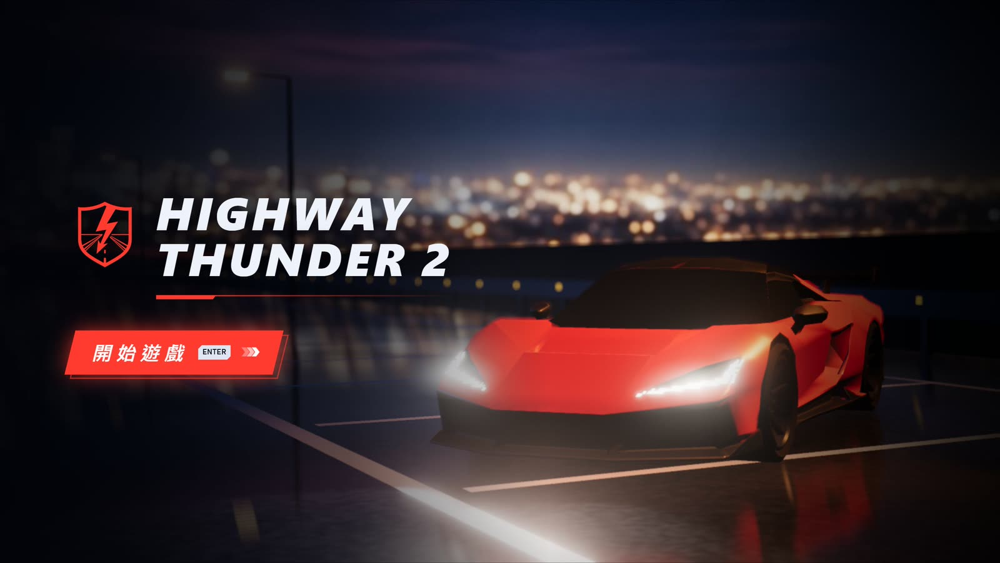
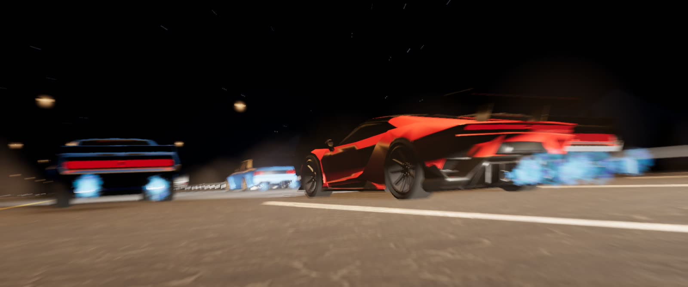
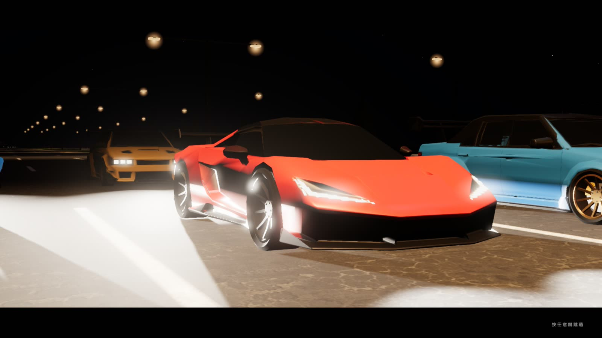
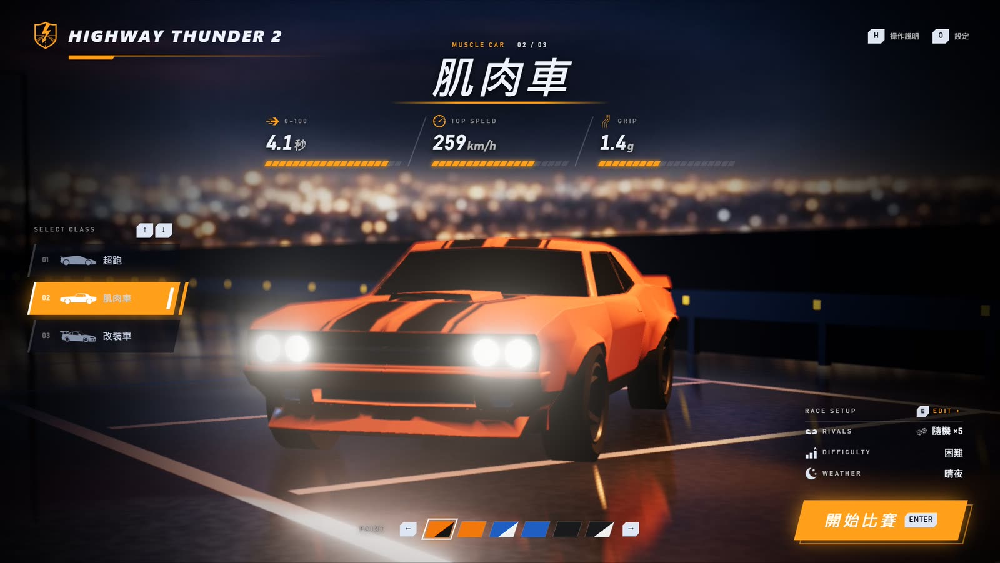
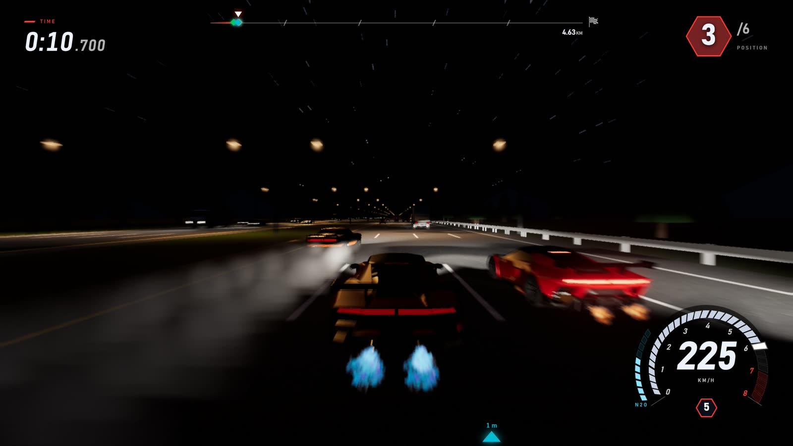
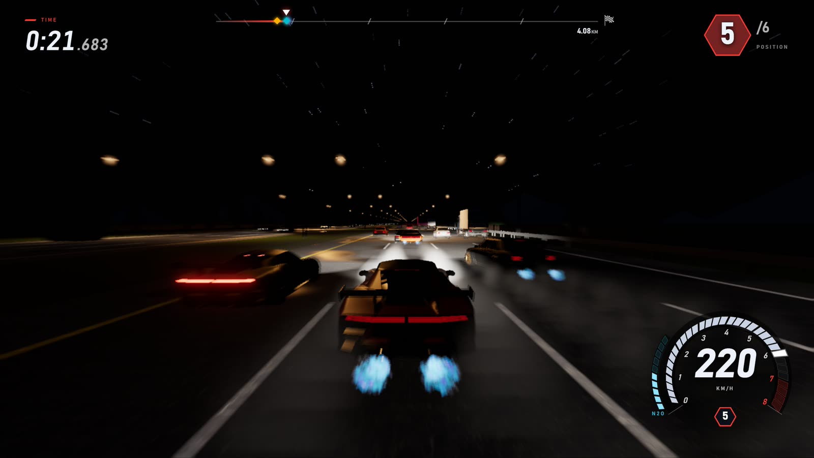
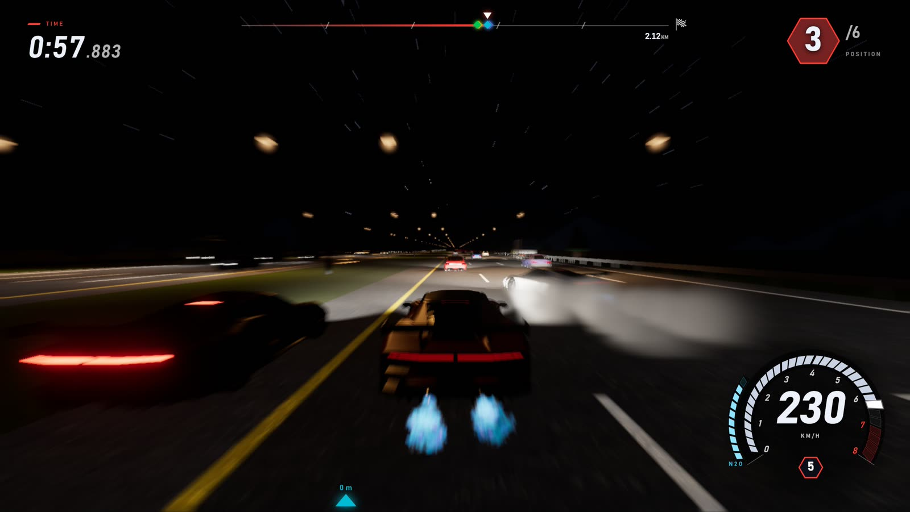
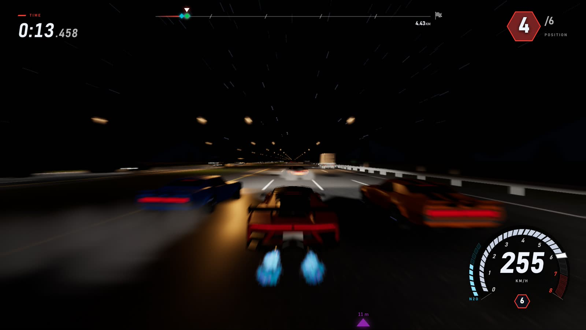

# Highway Thunder 2

[中文](README.md) | **English**



*Highway Thunder 2* is a 3D night-time highway racer that runs in the browser. A four-lane highway after dark is packed with cars, trucks and container lorries; fight it out with up to five rivals, thread the traffic, hit the nitro to get past, and be first across the line 5 km down the road.

## Play online

https://highwaythunder2.wwwang.tw/

## Features

- **Three very different cars**: the supercar has the highest top speed, the muscle car the fiercest launch, the tuner the most cornering grip, and each comes in several paint jobs.
- **Up to five rivals at once**: their cars drawn at random, all the same as yours, or picked one by one. The four difficulty levels differ only in how fast the rivals may go. At every level the rivals behind speed up to catch you and the ones ahead slow down for you, so the fight stays close all race long.
- **AI that can drive**: each rival plans the fastest line that won't hit anything, and a neural network trained for its car follows it, reading the traffic and slipping through the gaps.
- **Living traffic**: cars, trucks and container lorries follow one another and signal before they change lanes, with traffic on the oncoming carriageway too.
- **Real physics**: every vehicle is a rigid body. Scrapes throw sparks, a rear-end crash can set off a pile-up, and an overturned car slides along the road.
- **Nitro and near misses**: hold the nitro for a blue exhaust flame; squeezing past traffic by a hair scores near misses.
- **Night lighting**: headlights with a low-beam cut-off, street lights, brake lights, tyre smoke lit by the lamps around it, skid marks on the road, and motion blur at speed.
- **Immersive audio**: the engines follow revs and throttle, other cars are heard from where they are with Doppler shift, and there's tyre squeal and the sound of crashes.
- **Cinematic camera**: an opening shot of the grid rolling in, and a slow-motion finish once you cross the line.

## Screenshots



<table>
  <tr>
    <td width="50%"></td>
    <td width="50%"></td>
  </tr>
  <tr>
    <td></td>
    <td></td>
  </tr>
  <tr>
    <td></td>
    <td></td>
  </tr>
</table>

## The cars

| Car | 0–100 km/h | Top speed | Cornering grip |
| --- | --- | --- | --- |
| Supercar | 3.6 s | 300 km/h | 2.0 g |
| Muscle car | 4.1 s | 259 km/h | 1.4 g |
| Tuner | 4.0 s | 245 km/h | 2.4 g |

## Race setup

| Setting | Options |
| --- | --- |
| Rivals | 0–5 |
| Rivals' cars | All random / all my car / custom |
| Difficulty | Easy, Normal, Hard, Extreme (the rivals top out at 85% / 90% / 95% / 100% of their cars' top speed) |
| Weather | Clear night (rain and fog coming soon) |

## Controls

| Key | Action |
| --- | --- |
| `W` / `↑` | Throttle |
| `S` / `↓` | Brake / reverse |
| `A` `D` / `←` `→` | Steer |
| `Shift` | Nitro |
| `C` | Hold to look back |
| `V` | Hood camera |
| `X` | Hold for high beam |
| `R` | Back on the road |
| `I` | AI takes the wheel |
| `Esc` | Pause |
| `M` | Mute |

In the garage, `↑` `↓` change the car and `←` `→` its paint; `E` opens the race setup (`0`–`5` set the number of rivals), `H` shows the controls, `O` opens the settings (language, quality), and `Enter` starts the race.

## Play locally

```bash
npm install
npm run dev
```

Requires [Node.js](https://nodejs.org/); then open `http://localhost:5173`. A desktop browser and a keyboard are recommended. The sound assets are not in this repository, so a local build runs without sound.

## Development

```bash
npm test          # unit tests (vitest)
npm run build     # type check + build to dist/
```

- `src/traffic/`, `src/sim/`: traffic simulation (IDM car following, MOBIL lane changes)
- `src/ai/`: the rivals' route planner and driving network
- `src/vehicles/`: handling, tyres, nitro and the car models
- `src/physics/`: the Rapier physics world
- `src/game/`: race flow, rivals, timing and resets
- `src/world/`, `src/render/`, `src/ui/`, `src/audio/`: scene, effects, interface and sound

During development, `` ` `` opens the tuning panel.

---

Built with TypeScript, Three.js, Rapier and Vite.
