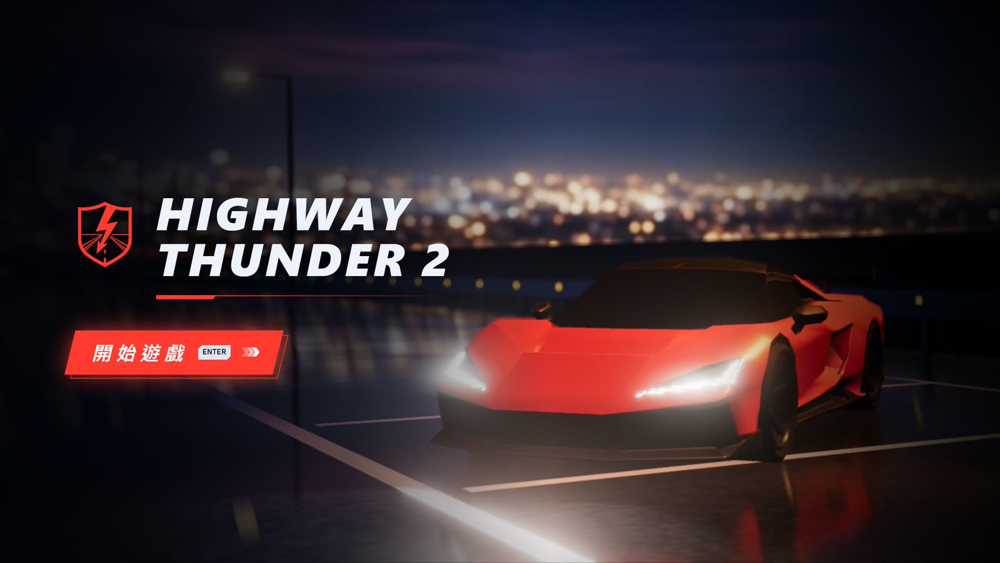
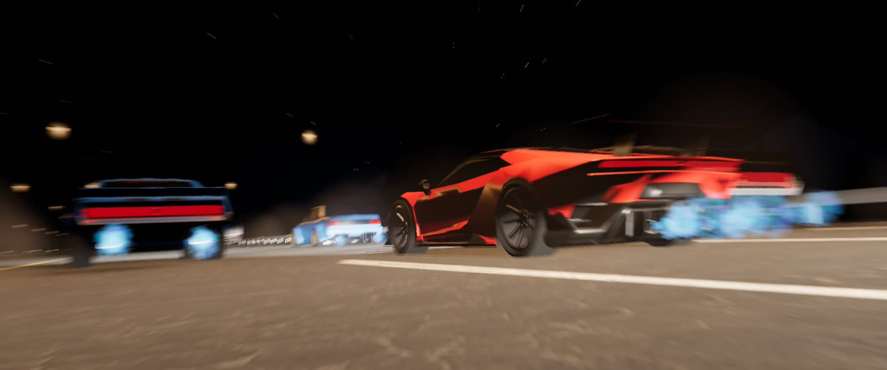
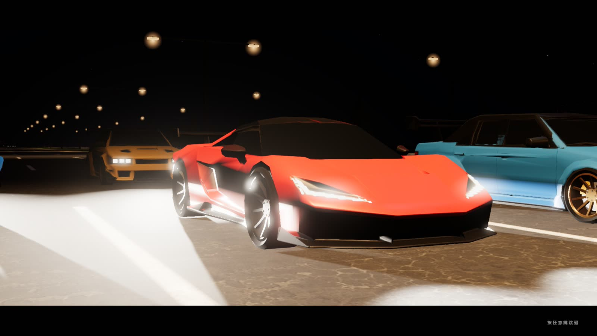
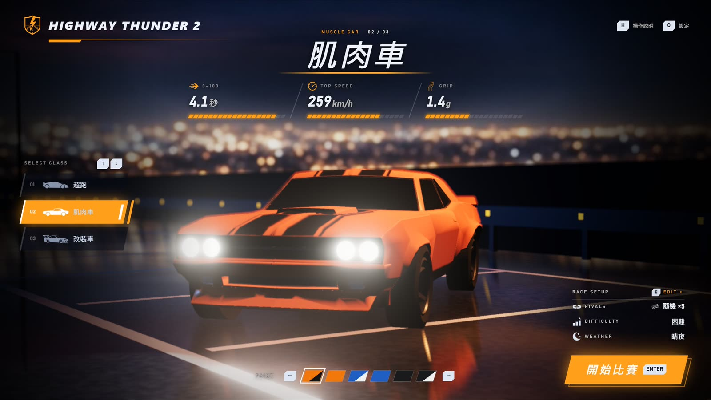
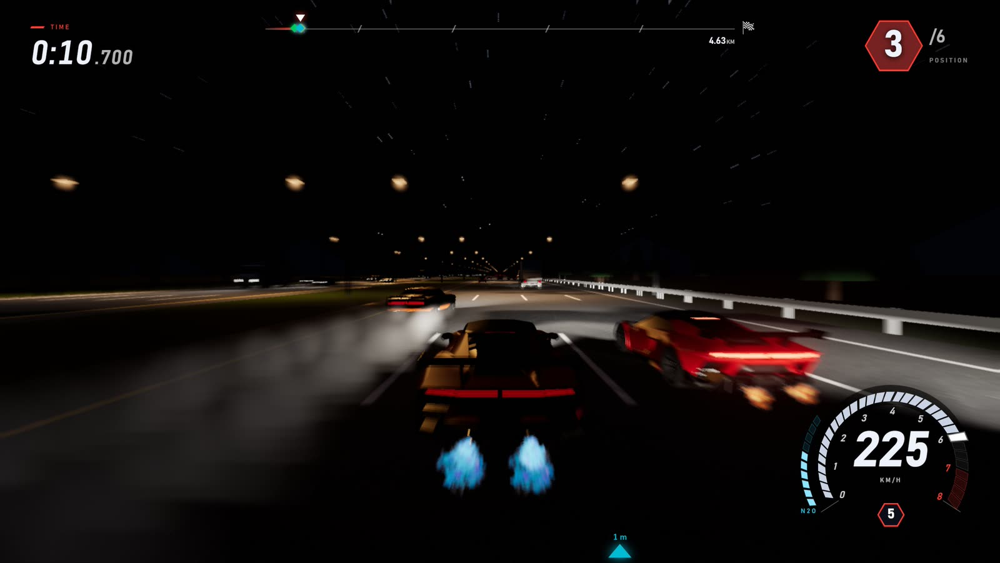
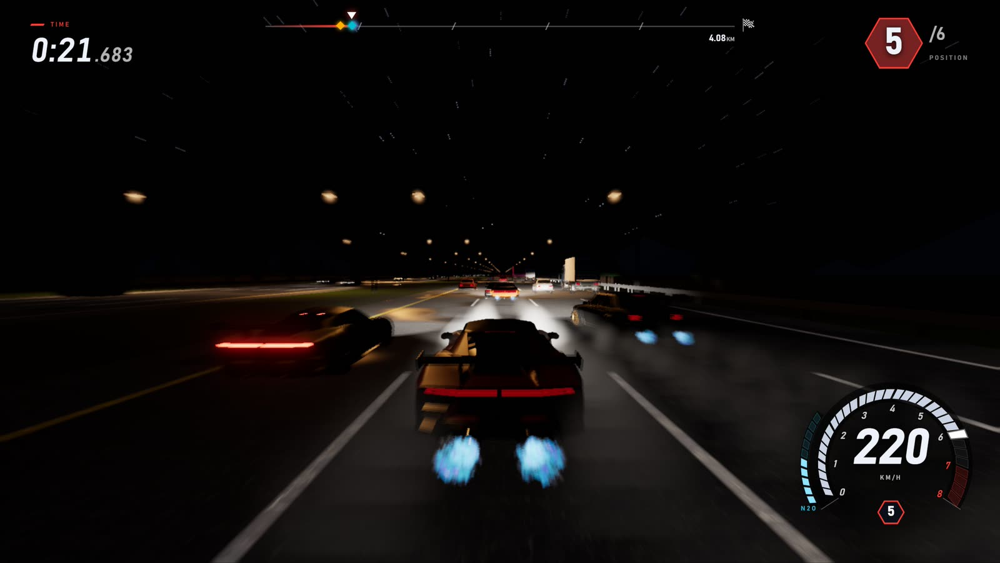
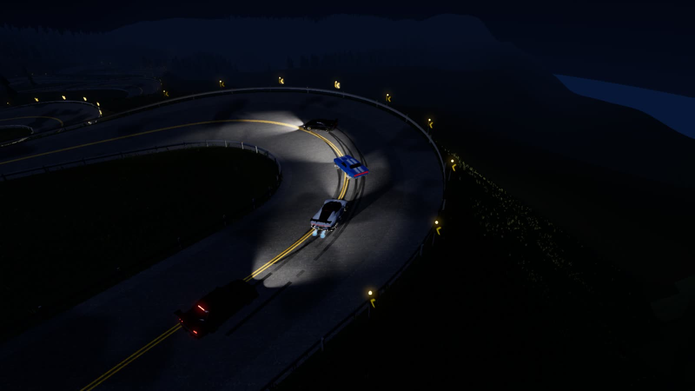
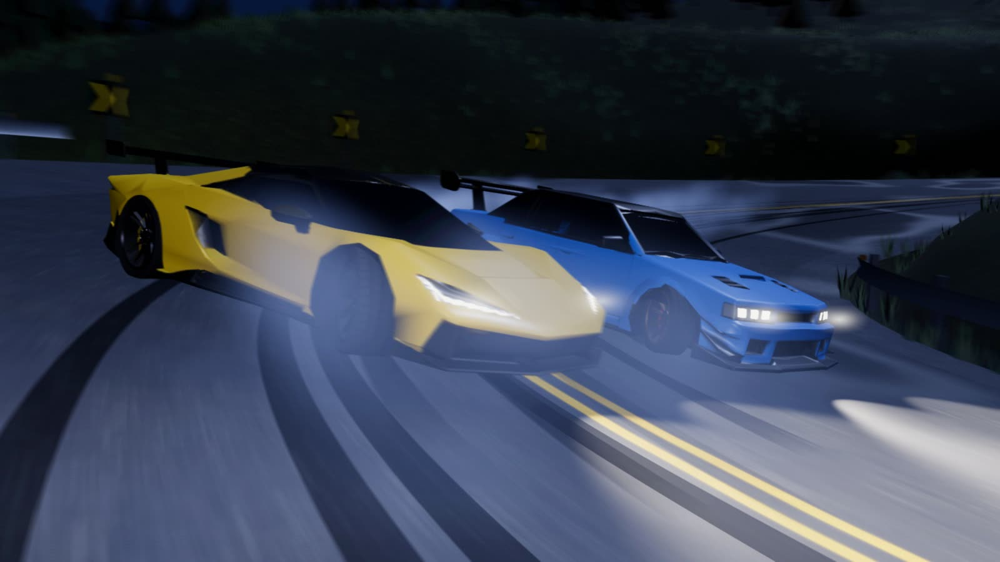

# Highway Thunder 2

[中文](README.md) | **English**



*Highway Thunder 2* is a 3D night-time street racer that runs in the browser. Thread the traffic on a packed highway and hit the nitro to get past, or take it to a winding mountain road and drift through the hairpins door to door with your rivals - and be first across the line.

## Play online

https://highwaythunder2.wwwang.tw/

## Features

- **Two courses**: a four-lane highway after dark, busy with cars, trucks and container lorries, with up to five rivals; or a winding mountain road, hairpin after hairpin, up and down hill, with up to three rivals right on your bumper.
- **Three very different cars**: the supercar, the muscle car and the tuner each have their strengths; every one comes in several paint jobs, and you can tune them yourself.
- **Always a fight**: the rivals' cars drawn at random, all the same as yours, or picked one by one; four difficulty levels, from easy-going to flat out. The rivals behind speed up to catch you and the ones ahead slow down for you, so there's always someone alongside.
- **Rivals that can drive**: they read the traffic and slip through the gaps, and on the mountain road they fight for the line and drift through the bends.
- **Living traffic**: on the highway, cars follow one another and signal before they change lanes, with traffic on the oncoming side too.
- **Real crashes**: scrapes throw sparks, a rear-end hit can set off a pile-up, an overturned car slides along the road - and riding the guardrail slows you down.
- **Nitro, near misses and drifts**: hold the nitro for a blue exhaust flame; squeezing past traffic by a hair scores near misses; drifts get called out too.
- **Night lighting**: headlights and high beams, street lights, brake lights, tyre smoke lit by the lamps around it, skid marks on the road, and motion blur at speed.
- **Sound and music**: the engines follow revs and throttle, and you can hear where the other cars are; there's music in the race, and you can skip to the next song any time.
- **Cinematic camera**: an opening shot of the grid rolling in and a slow-motion finish once you cross the line - both skippable.

## Screenshots



<table>
  <tr>
    <td width="50%"></td>
    <td width="50%"></td>
  </tr>
  <tr>
    <td></td>
    <td></td>
  </tr>
  <tr>
    <td></td>
    <td></td>
  </tr>
</table>

## The cars

| Car | Character |
| --- | --- |
| Supercar | The highest top speed and balanced handling; at its best on the long straights |
| Muscle car | The fiercest launch, off the line like a shot; the least grip, its tail always ready to step out |
| Tuner | The most cornering grip, at home on the twisty mountain road; the lowest top speed |

## Race setup

| Setting | Options |
| --- | --- |
| Course | Highway, mountain road |
| Rivals | 0–5 on the highway, 0–3 on the mountain road |
| Rivals' cars | All random / all my car / custom |
| Difficulty | Easy, Normal, Hard, Extreme (the rivals from easy-going to flat out) |
| Weather | Clear night (rain and fog coming soon) |

## Controls

| Key | Action |
| --- | --- |
| `W` / `↑` | Throttle |
| `S` / `↓` | Brake / reverse |
| `A` `D` / `←` `→` | Steer |
| `Space` | Handbrake (rear wheels lock: the tail slides) |
| `Shift` | Nitro |
| `C` | Hold to look back |
| `Q` / `E` | Hold to look left / right |
| `V` | Hood camera |
| `X` | High beam on / off |
| `R` | Back on the road |
| `I` | AI takes the wheel |
| `Esc` | Pause |
| `Esc` / `Space` | Skip the opening shot or the slow-motion finish |
| `M` | Mute |
| `N` | Next song |

In the garage, `↑` `↓` change the car and `←` `→` its paint; `E` opens the race setup (`0`–`5` set the number of rivals), `T` the tuning, `H` shows the controls, `O` opens the settings (language, quality, volume), and `Enter` starts the race.

## Play locally

```bash
npm install
npm run dev
```

Requires [Node.js](https://nodejs.org/); then open `http://localhost:5173`. A desktop browser and a keyboard are recommended. The sound assets are not in this repository, so a local build runs without sound.
