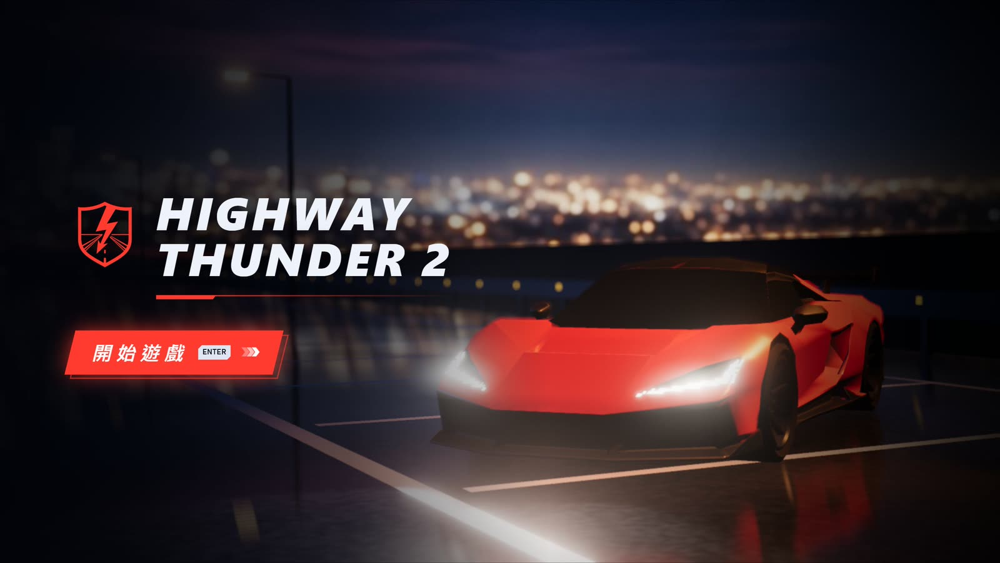
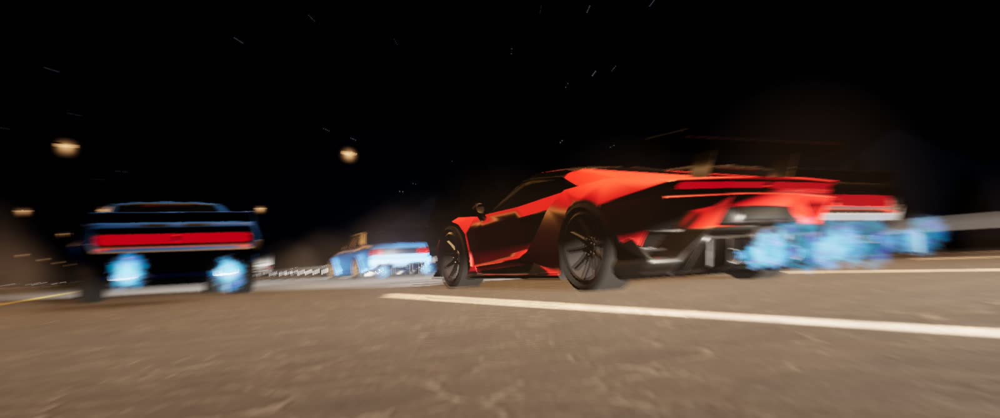
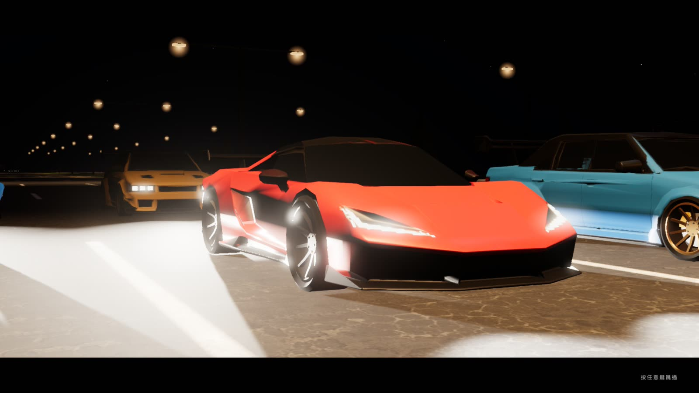
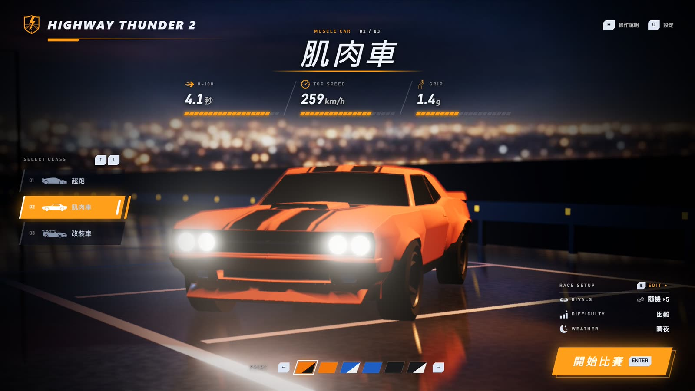
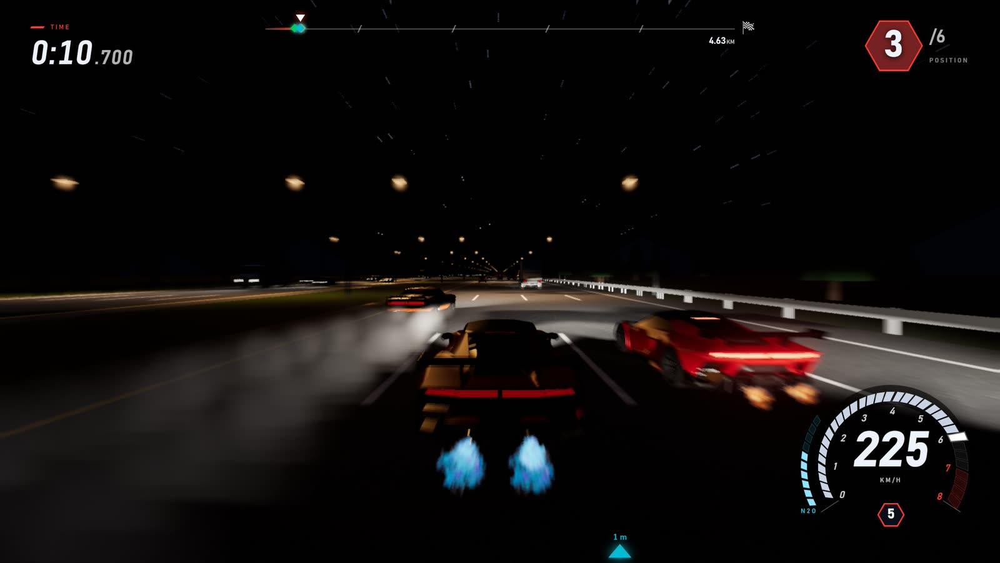
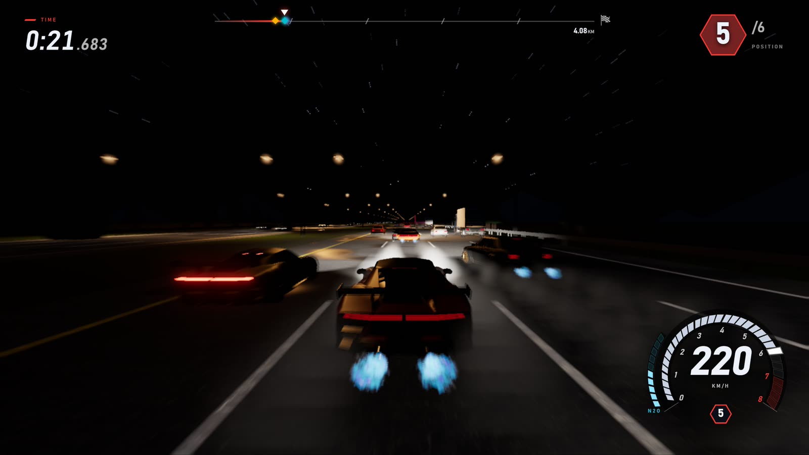
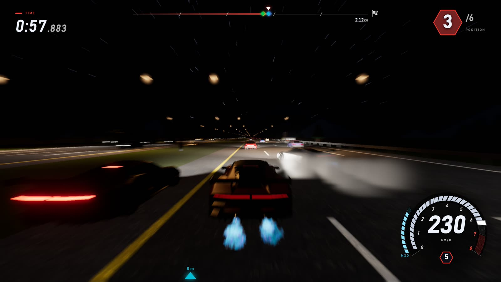
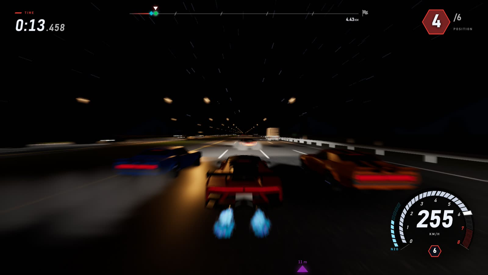

# Highway Thunder 2

**中文** | [English](README.en.md)



《Highway Thunder 2》是一款在瀏覽器裡玩的 3D 夜間高速公路賽車。深夜的四線道快速道路上擠滿了轎車、貨車與貨櫃車，你要和最多五台對手一路纏鬥，鑽過車流、噴氮氣超車，最先衝過 5 公里外的終點。

## 線上遊玩

https://highwaythunder2.wwwang.tw/

## 遊戲特色

- **三台風格迥異的車**：超跑極速最高、肌肉車起步兇猛、改裝車過彎抓地力最強，每台都有多種烤漆可選。
- **最多五台對手同場**：對手的車可以全部隨機、全部跟你同款，或逐台指定；四種難度只差在對手能開多快。不論哪種難度，落後的對手都會加速追趕、領先的會放慢等你，整場比賽一直有人在身邊纏鬥。
- **會開車的 AI**：對手先規劃出最快又不會撞車的路線，再由針對各車種訓練的神經網路照著開，會判斷車流、找縫鑽過去。
- **活的車流**：轎車、貨車與貨櫃車會跟車、打方向燈換車道，對向車道也有來車。
- **真實的物理碰撞**：車輛以剛體模擬，擦撞會噴出火花，追撞會引發連環車禍，翻覆的車會在路面上滑行。
- **氮氣與險過**：按住氮氣噴出藍色尾焰，從車縫間險險擦過還會計分。
- **夜間光影**：車燈的近光截止線、路燈、煞車燈、輪胎煙霧被燈光照亮、地上的煞車痕、高速時的動態模糊。
- **臨場音效**：引擎聲隨轉速與油門變化，其他車的聲音有方向感與都卜勒效應，還有胎噪與撞擊聲。
- **電影感運鏡**：開場有車隊進場的運鏡，衝線後有慢動作的終點鏡頭。

## 遊戲畫面



<table>
  <tr>
    <td width="50%"></td>
    <td width="50%"></td>
  </tr>
  <tr>
    <td></td>
    <td></td>
  </tr>
  <tr>
    <td></td>
    <td></td>
  </tr>
</table>

## 三台車

| 車種 | 0–100 km/h | 極速 | 過彎抓地力 |
| --- | --- | --- | --- |
| 超跑 | 3.6 秒 | 300 km/h | 2.0 g |
| 肌肉車 | 4.1 秒 | 259 km/h | 1.4 g |
| 改裝車 | 4.0 秒 | 245 km/h | 2.4 g |

## 比賽設定

| 項目 | 選項 |
| --- | --- |
| 對手數量 | 0–5 台 |
| 對手車種 | 全部隨機／全部同我的車／自由指定 |
| 難度 | 簡單、普通、困難、極限（對手最高開到車子極速的 85%／90%／95%／100%） |
| 天氣 | 晴夜（雨夜、霧夜即將推出） |

## 操作方式

| 按鍵 | 功能 |
| --- | --- |
| `W` / `↑` | 油門 |
| `S` / `↓` | 煞車／倒車 |
| `A` `D` / `←` `→` | 轉向 |
| `Space` | 手煞車（鎖後輪，甩尾） |
| `Shift` | 氮氣 |
| `C` | 按住看正後方 |
| `V` | 切換引擎蓋視角 |
| `X` | 按住開遠光燈 |
| `R` | 重置回車道上 |
| `I` | AI 接手駕駛 |
| `Esc` | 暫停 |
| `M` | 靜音 |

車庫裡用 `↑` `↓` 換車、`←` `→` 換烤漆，`E` 打開比賽設定（`0`–`5` 直接設定對手數量），`H` 看操作說明，`O` 打開設定（語言、畫質），`Enter` 開始比賽。

## 本機遊玩

```bash
npm install
npm run dev
```

需要 [Node.js](https://nodejs.org/)；啟動後開啟 `http://localhost:5173`。建議使用桌面瀏覽器與鍵盤。音效素材不包含在這個 repo 中，本機執行時遊戲沒有聲音。

## 開發

```bash
npm test          # 單元測試（vitest）
npm run build     # 型別檢查 + 建置到 dist/
```

- `src/traffic/`、`src/sim/`：車流模擬（IDM 跟車、MOBIL 換車道）
- `src/ai/`：對手的路線規劃與駕駛神經網路
- `src/vehicles/`：車輛操控、輪胎、氮氣與車輛模型
- `src/physics/`：Rapier 物理世界
- `src/game/`：比賽流程、對手、計時與重置
- `src/world/`、`src/render/`、`src/ui/`、`src/audio/`：場景、特效、介面與音效

開發時按 `` ` `` 可開啟調校面板。

---

Built with TypeScript, Three.js, Rapier and Vite.
