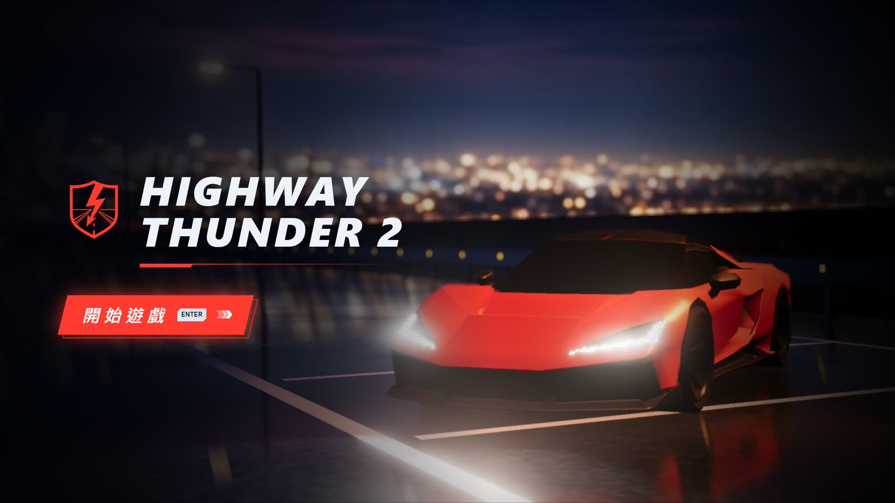
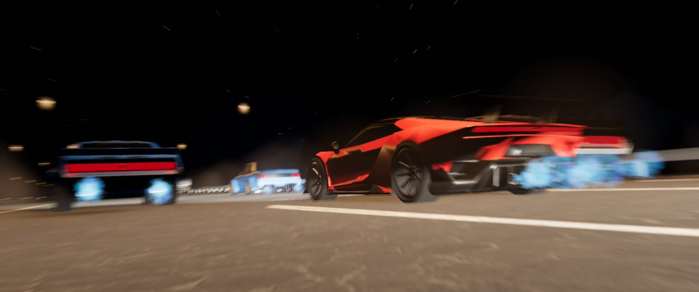
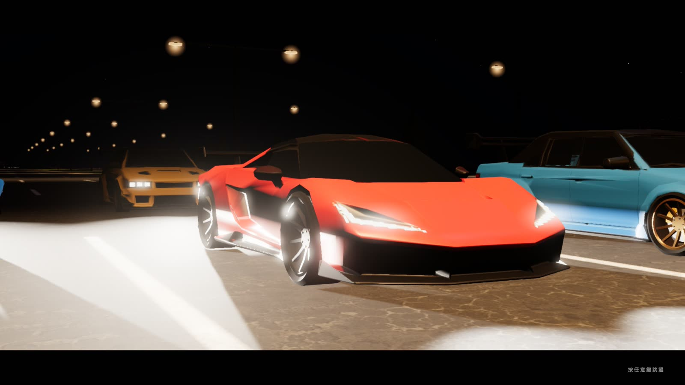
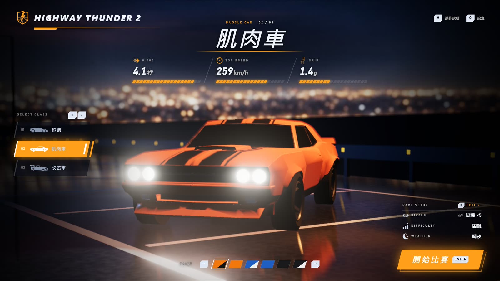
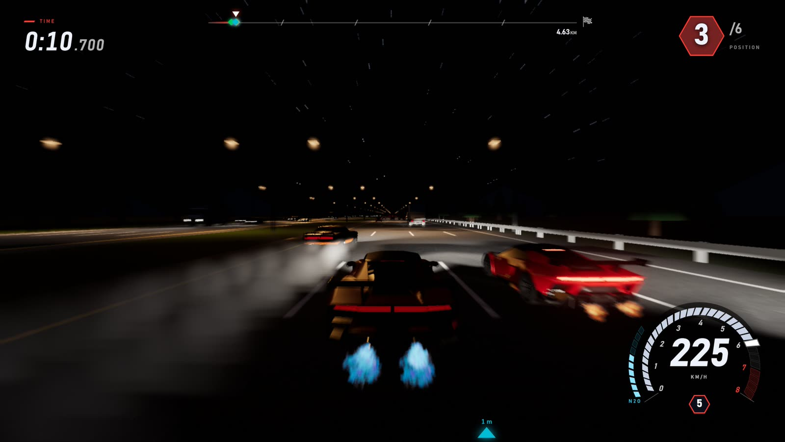
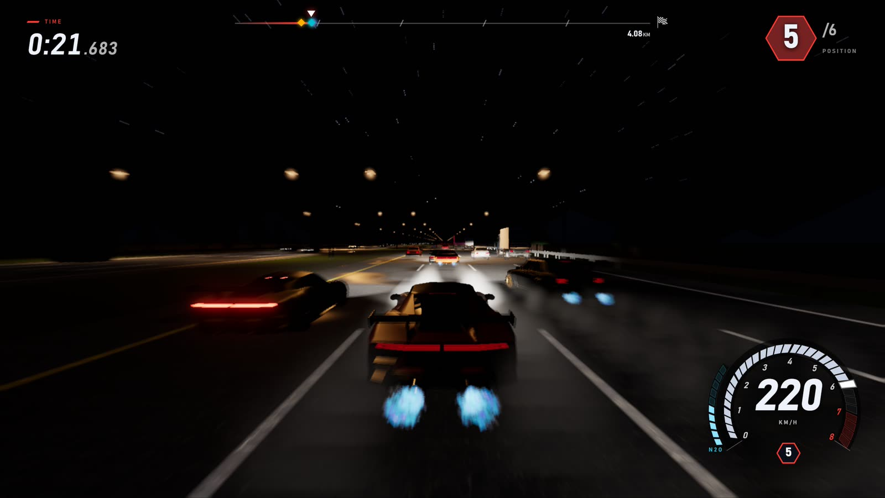
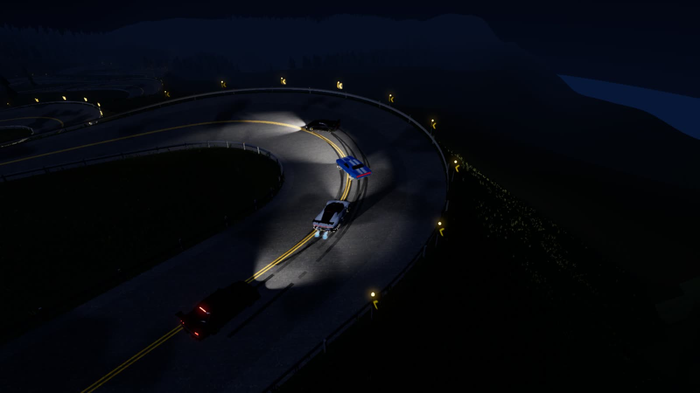
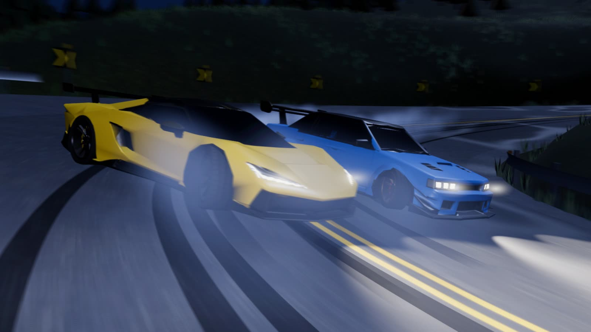

# Highway Thunder 2

**中文** | [English](README.en.md)



《Highway Thunder 2》是一款在瀏覽器裡玩的 3D 夜間街頭賽車。你可以在擠滿車流的高速公路上鑽車縫、噴氮氣超車，也可以到彎道一個接一個的山路上，和對手並排甩過髮夾彎，搶先衝過終點。

## 線上遊玩

https://highwaythunder2.wwwang.tw/

## 遊戲特色

- **兩條路線**：深夜的四線道高速公路，車流裡有轎車、貨車和貨櫃車，最多五台對手同場；或是蜿蜒的山路，髮夾彎、上下坡一個接一個，最多三台對手貼身纏鬥。
- **三台個性不同的車**：超跑、肌肉車、改裝車各有拿手的地方，每台都有多種烤漆，還能自己調校。
- **一直有人跟你纏鬥**：對手的車可以全部隨機、全部跟你同款，或逐台指定；四種難度由輕鬆到全力。落後的對手會加速追上來，領先的會放慢等你，整場都有人在身邊。
- **會開車的對手**：對手會看車流找縫鑽過去，在山路上會搶線、甩尾過彎。
- **活的車流**：高速公路上的車會跟車、打方向燈換車道，對向車道也有來車。
- **真實的碰撞**：擦撞會噴出火花，追撞可能引發連環車禍，翻覆的車會在路面上滑行；擦著護欄走會被拖慢。
- **氮氣、險過與甩尾**：按住氮氣噴出藍色尾焰；從車縫間險險擦過會計分；甩尾也會跳出提示。
- **夜間光影**：車燈、遠光燈、路燈、煞車燈，被燈光照亮的輪胎煙霧、地上的胎痕，還有高速時的動態模糊。
- **臨場音效與音樂**：引擎聲隨轉速和油門變化，聽得出其他車從哪裡經過；比賽中有背景音樂，可以隨時換歌。
- **電影感運鏡**：開場有車隊進場的運鏡，衝線後有慢動作的終點鏡頭，都可以按鍵跳過。

## 遊戲畫面



<table>
  <tr>
    <td width="50%"></td>
    <td width="50%"></td>
  </tr>
  <tr>
    <td></td>
    <td></td>
  </tr>
  <tr>
    <td></td>
    <td></td>
  </tr>
</table>

## 三台車

| 車種 | 特色 |
| --- | --- |
| 超跑 | 極速最快，操控平衡，長直線上最有優勢 |
| 肌肉車 | 起步最猛，一踩油門就衝出去；抓地力最少，車尾很容易甩出去 |
| 改裝車 | 過彎抓地力最好，在彎道多的山路最拿手；極速最慢 |

## 比賽設定

| 項目 | 選項 |
| --- | --- |
| 路線 | 高速公路、山路 |
| 對手數量 | 高速公路 0–5 台，山路 0–3 台 |
| 對手車種 | 全部隨機／全部同我的車／自由指定 |
| 難度 | 簡單、普通、困難、極限（對手由輕鬆跑到全力衝刺） |
| 天氣 | 晴夜（雨夜、霧夜即將推出） |

## 操作方式

| 按鍵 | 功能 |
| --- | --- |
| `W` / `↑` | 油門 |
| `S` / `↓` | 煞車／倒車 |
| `A` `D` / `←` `→` | 轉向 |
| `Space` | 手煞車（鎖後輪，甩尾） |
| `Shift` | 氮氣 |
| `C` | 按住看正後方 |
| `Q` / `E` | 按住看左側／右側 |
| `V` | 切換引擎蓋視角 |
| `X` | 開／關遠光燈 |
| `R` | 重置回車道上 |
| `I` | AI 接手駕駛 |
| `Esc` | 暫停 |
| `Esc` / `Space` | 跳過開場運鏡、終點慢動作 |
| `M` | 靜音 |
| `N` | 下一首音樂 |

車庫裡用 `↑` `↓` 換車、`←` `→` 換烤漆，`E` 打開比賽設定（`0`–`5` 直接設定對手數量），`T` 打開調校，`H` 看操作說明，`O` 打開設定（語言、畫質、音量），`Enter` 開始比賽。

## 本機遊玩

```bash
npm install
npm run dev
```

需要 [Node.js](https://nodejs.org/)；啟動後開啟 `http://localhost:5173`。建議使用桌面瀏覽器與鍵盤。音效素材不包含在這個 repo 中，本機執行時遊戲沒有聲音。
